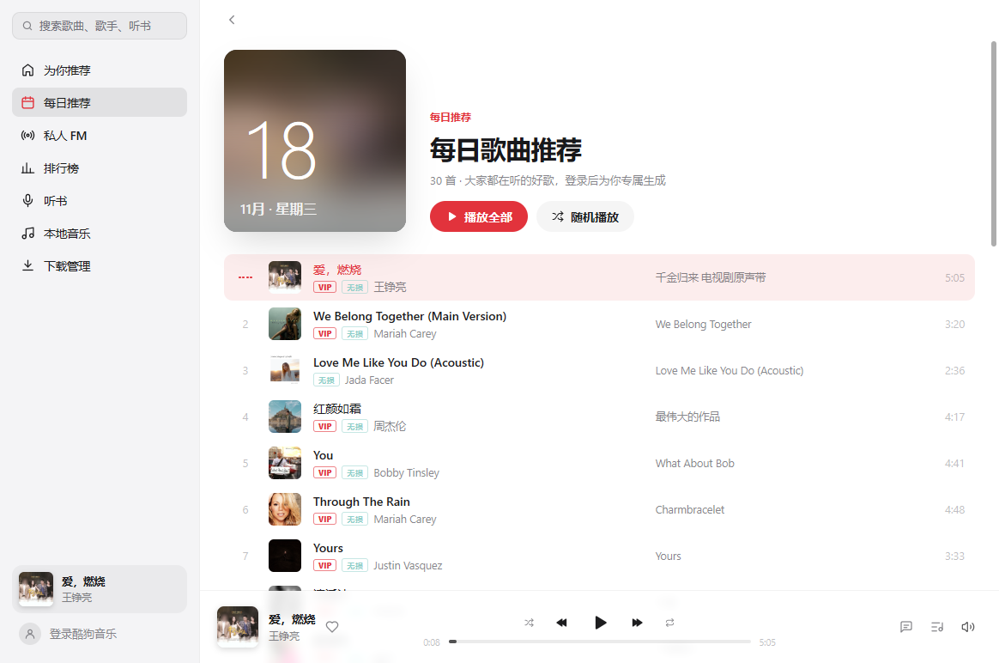
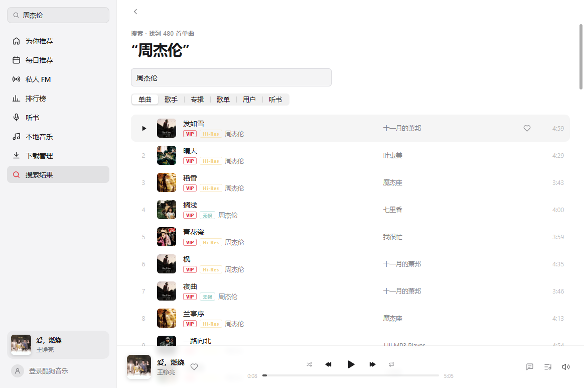
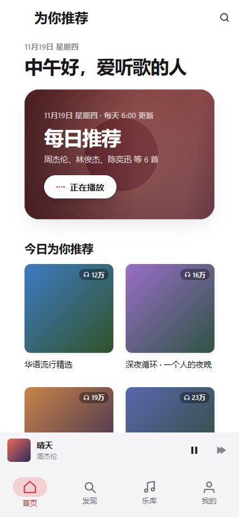
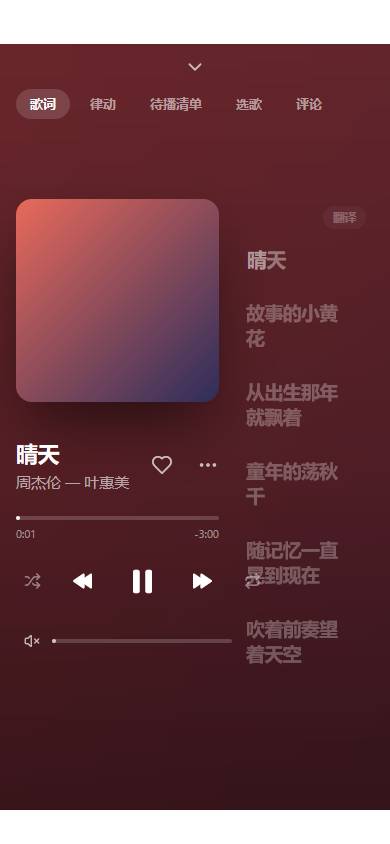
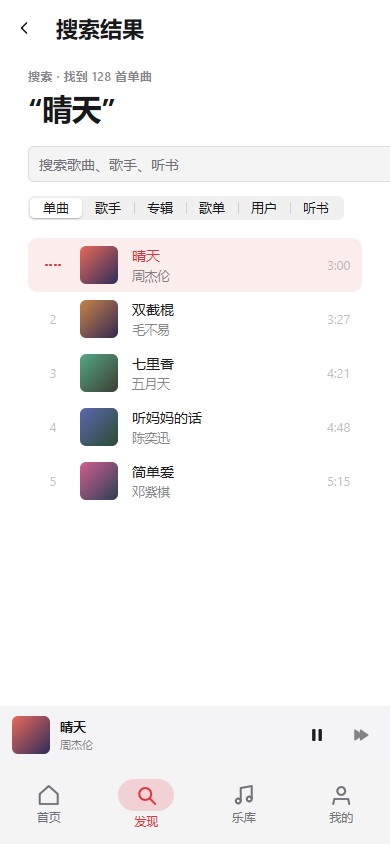
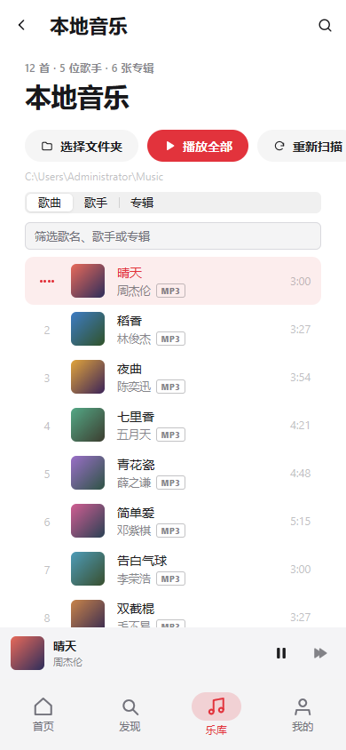
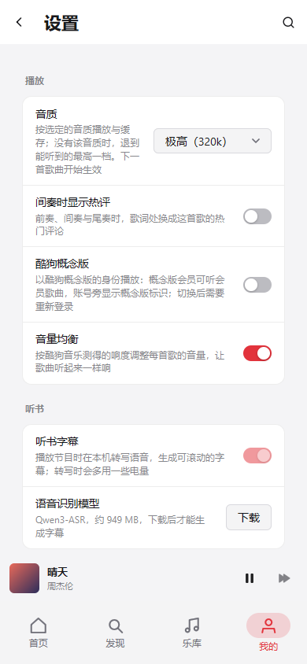

# 酷狗音乐 · MyGo

用 Go 和 [MyGo](https://github.com/egoist/mygo) 写的第三方酷狗音乐客户端，原生界面，无 WebView。桌面之外也在做手机端：同一份代码，iPhone / iPad 与 Android 各出一个应用。

## 界面

桌面：

| 为你推荐 | 每日推荐 |
| --- | --- |
|  |  |
| **搜索** | **正在播放** |
|  |  |

手机端是同一套界面：底部四个页签（首页 / 发现 / 乐库 / 我的），上方一条迷你播放条，点它展开正在播放页。

| 首页 | 正在播放 | 搜索 |
| --- | --- | --- |
|  |  |  |
| **本地音乐** | **设置** | |
|  |  | |

## 功能

- 扫码登录，登录态保存在系统凭据存储中
- 每日推荐、推荐歌单、排行榜、我的歌单
- 搜索单曲、歌手、专辑、用户与听书，输入时显示搜索建议，保留搜索历史；搜索框空着时列出当天热搜，结果页能原地改词，边打边出结果
- 歌手页的热门与最新歌曲、专辑与动态，关注歌手；专辑页与用户页
- 听书：浏览与收听节目，订阅听书；在本机把节目转写成字幕（Qwen3-ASR），像歌词一样随播放滚动
- 私人 FM（推荐 / 熟悉 / 探索）与心动模式；场景电台（助眠、车载、工作学习等 11 个场景），一页接一页地放
- 歌曲菜单里的「听相似的歌」：以这首歌为种子接着放，不是凭口味重开一台电台
- 歌曲成绩单：这首歌到过哪些榜，各榜的最高名次、在榜次数与最近一次
- 榜单往期：榜单的每一期都能翻回去听，一期的 500 首，随时回到最新
- 评论热词：评论上方的词点一下就筛出含这个词的评论，再点一下看全部
- 我的歌单可换封面、可上移下移（顺序保存在账号里，换设备也一样）
- 边下边播，支持标准 / 较高 / 极高 / 无损（FLAC）/ Hi-Res 音质
- 本地音乐：读取自己的音乐文件夹（MP3 / FLAC / Ogg Vorbis / Opus / M4A（AAC 与 ALAC）/ WAV），
  直接从文件播放，标签、内嵌封面与歌词都从文件读，文件夹比邻的 cover.jpg 与 .lrc 同样认；
  页面分「歌曲 / 歌手 / 专辑」三栏，点歌手或专辑进去只听那一些
- 音乐云盘：手机「我的 - 云盘」里的歌，这里能看、能听、能删；自己的文件也能传上去，
  与手机和标准版共用同一份云盘
- 听过的歌曲缓存在本机，再次播放无需等待
- 音量均衡，暂停与继续时淡出淡入，拖动进度无杂音
- 退出后再打开，从上次的播放队列与进度继续
- 逐字歌词与翻译，正在播放页的「律动」视图与歌曲评论
- 评论分「精彩 / 最新」两栏，可以发评论、回复他人，歌手本人的回复单独标出
- 刘海播放器：在屏幕顶部刘海处显示迷你播放器，悬停展开（在设置中开启）
- 喜欢歌曲、播放队列、随机与循环播放
- 浅色 / 深色 / 跟随系统

## 系统要求

| 平台 | 最低版本 |
| --- | --- |
| Windows | Windows 10 |
| macOS | 13.0 |
| Linux | GTK 3（原生界面，不依赖 WebKitGTK） |
| iOS | 17.0 |
| Android | 8.0（API 26） |

客户端用原生界面，不显示网页，所以 Windows 不必装 WebView2 Runtime、Linux 只需 GTK 3。

## 构建

需要 Go 1.27+。

```bash
go tool mygo dev     # 开发模式运行
go tool mygo build   # 打包到 build/
go test ./...        # 运行测试
```

手机端由 GitHub Actions 的 `Mobile` 工作流在每次发版标签上构建，也可在 Actions 页手动触发：

- **iOS**：产出模拟器用的 `.app`（免签名、免开发者账号），因为设备版 `.ipa` 必须要描述文件签名；真机与上架需要另行配置 `ios.team` 与描述文件。最低支持 iOS 17.0（mygo 宿主用到了仅 iOS 17 才有的系统 API，见上表）。
- **Android**：产出 `.apk` 与 `.aab`，用上传密钥签名。在仓库的 Secrets 里设置：

| 名称 | 类型 | 用途 |
| --- | --- | --- |
| `ANDROID_KEYSTORE_BASE64` | Secret | `.jks` 上传密钥的 base64（`base64 -w0 upload.jks`） |
| `ANDROID_KEYSTORE_PASSWORD` | Secret | 密钥库密码 |
| `ANDROID_KEY_PASSWORD` | Secret | 密钥密码；与密钥库密码相同可留空 |
| `ANDROID_KEY_ALIAS` | Secret | 密钥别名，默认 `upload` |

不设置这些变量时仍会构建，但 Android 用调试密钥签名，Google Play 不接受。

## 致谢

- [MyGo](https://github.com/egoist/mygo)：原生 UI 与应用框架
- [NeteaseCloudMusicApi](https://github.com/Binaryify/NeteaseCloudMusicApi)：eapi 加密与登录流程的参考
- [folia-major](https://github.com/chthollyphile/folia-major)：歌词动画效果的参考
- [sherpa-onnx](https://github.com/k2-fsa/sherpa-onnx)、[Qwen3-ASR](https://github.com/QwenLM/Qwen3-ASR) 与 [Silero VAD](https://github.com/snakers4/silero-vad)：本机语音识别
- MyGo 自带的解码器：M4A 里的 AAC 与 ALAC、FLAC、Ogg Vorbis
- [gopus](https://github.com/thesyncim/gopus)：Ogg Opus

本项目与酷狗音乐官方无关，音乐版权归各权利人所有。

## 许可证

[AGPL-3.0](LICENSE)
